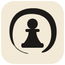
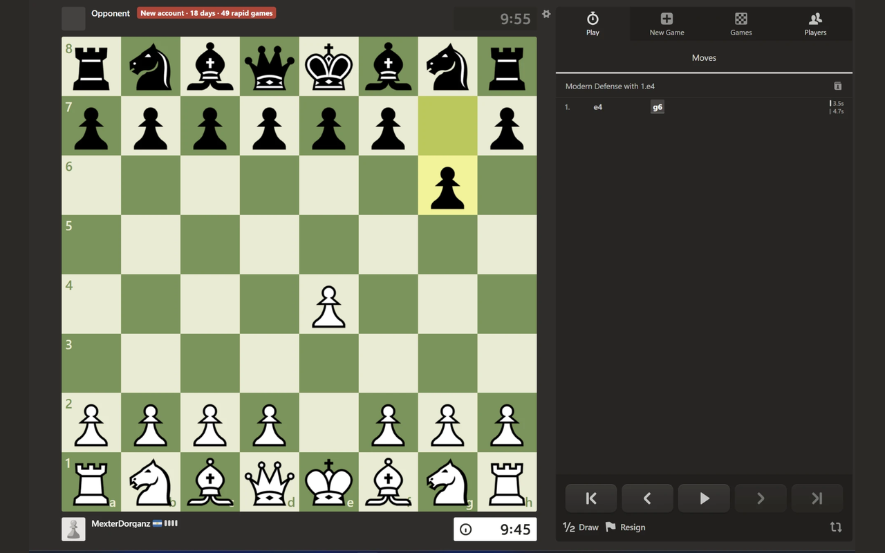

# ZenChess

A browser extension that makes chess.com anonymous: while you play, your
opponent's name, avatar, rating, country flag and badges are hidden. It's
like playing a computer, with no rating anxiety and no tilt from seeing who's
across the board.

## What it hides

- Opponent (top player bar): avatar, username, rating, flag, badges/flair,
  hover cards and name tooltips. A plain "Opponent" label replaces them.
  The clock and captured pieces stay visible.
- Sidebar: the "name (rating) vs. name (rating), win +8 / lose -8" line, and
  the Chat and Info tabs.
- Pre-game "vs" animation.
- Game-over popup: the new rating and +/- change for both the opponent and
  you.
- Your own rating (on by default; toggle in the popup, works with Zen mode
  on or off): in the player bar, the sidebar "vs" line and the game-over
  popup.
- Home page: the whole Game History section (on by default; toggle in the
  popup, works with Zen mode on or off).

## Suspicious-opponent flag

A red badge appears next to "Opponent" when the account looks suspicious.
The name itself stays hidden. Two checks, each with its own toggle and
threshold in the popup (both on by default):

- **Account age**: under 30 days old.
- **Games played**: under 50 rated games in the mode you're playing
  (bullet, blitz, rapid or daily).

Either check alone shows the badge, listing whichever reasons apply:

- New account: "New account · 4 days".
- Few games in this mode, even on an old account: "12 rapid games".
- Both: "New account · 4 days · 12 rapid games".
- No public profile (e.g. guests): "No public profile".

If the games count is unknown (unrated variant, lookup failed), only account
age can flag.

Nothing shows when nothing is suspicious.

The data comes from chess.com's public API: the join date from
`api.chess.com/pub/player/<username>` and games per mode from `.../stats`.
There's no badge in games against bots or the coach.

## Settings

Click the ZenChess icon in the toolbar:

| Setting | Default | What it does |
|---|---|---|
| Zen mode | on | Hides the opponent's identity and ratings |
| Hide my rating | on | Hides your own rating wherever it shows during a game |
| Hide game history | on | Hides the Game History section on the home page |
| Account under N days old | on, 30 | Flags new accounts |
| Under N games in this mode | on, 50 | Flags opponents with few games in this mode |

Changes apply instantly to open chess.com tabs.

## Privacy and fair play

ZenChess collects no data and has no servers. Its only network requests go to
chess.com's own API, for the opponent's join date and games played. See
[PRIVACY.md](PRIVACY.md).

It only hides information and shows public profile data. It never reads the
board or suggests moves.

ZenChess is an independent project and is not affiliated with, endorsed by
or sponsored by Chess.com.

## Development

### Install from source (Chrome / Edge / Brave)

1. Download or clone this repo.
2. Go to `chrome://extensions` and turn on **Developer mode** (top right).
3. Click **Load unpacked** and select the `extension/` folder.
4. Open chess.com and play. Use the toolbar icon to turn Zen mode on or off.

After editing files, click the reload icon on the extension card, then refresh
chess.com.

### If something leaks

chess.com changes its page markup now and then. If a name or rating shows up,
right-click it, choose **Inspect**, and note the `class="..."` of the element
and its parent. Add that class to `extension/content.css`, or report it.